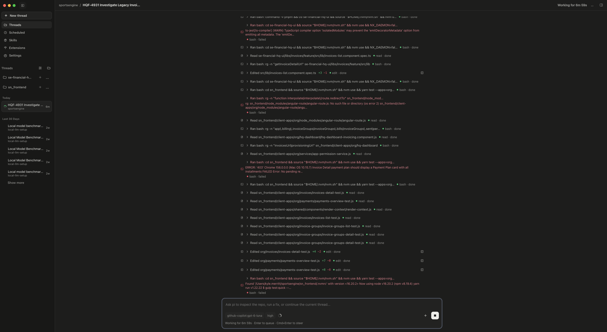

# Coding agent setup

Small macOS setup for the team's current coding agent: Pi with GPT-6 Luna through GitHub Copilot, plus pi-gui and the web search and fetch extensions. The installer sets Luna with high thinking as the default for new CLI sessions and GUI threads, and configures web search to use the Copilot model on a fresh install. GitHub Copilot sign-in remains interactive.

Here's pi-gui running a coding task with GitHub Copilot's GPT-6 Luna at high thinking:



## Quick start

On an Apple Silicon Mac, install [Homebrew](https://brew.sh/) if needed, then:

```sh
git clone https://github.com/kmerrittNBC/coding-agent-setup.git
cd coding-agent-setup
bash scripts/macos-coding-agent-setup.sh --preflight
bash scripts/macos-coding-agent-setup.sh
```

Follow the [setup and verification guide](docs/pi-luna-setup.md) to sign in and test the model and web tools. The installer can be rerun after an interrupted setup.

The [agent-evals report](https://github.com/kmerrittNBC/agent-evals/blob/main/docs/executive-report-2026-10-15.md) contains the evidence behind this choice; evaluation results and tooling are kept out of this repository.
