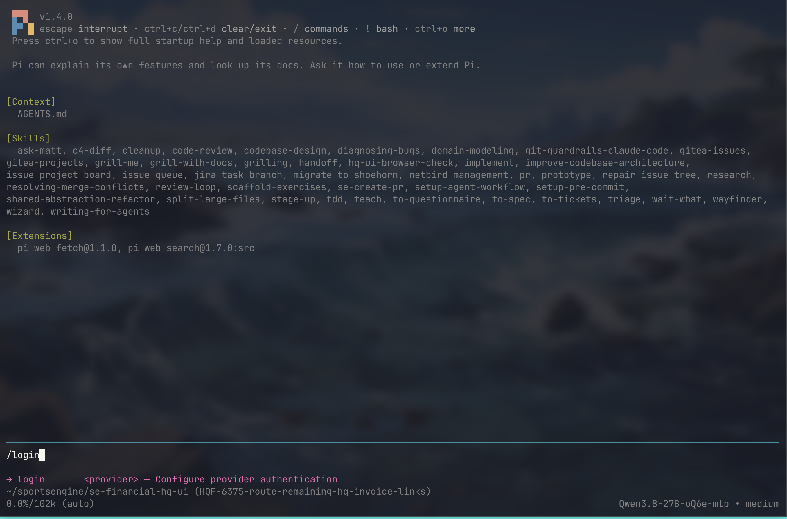
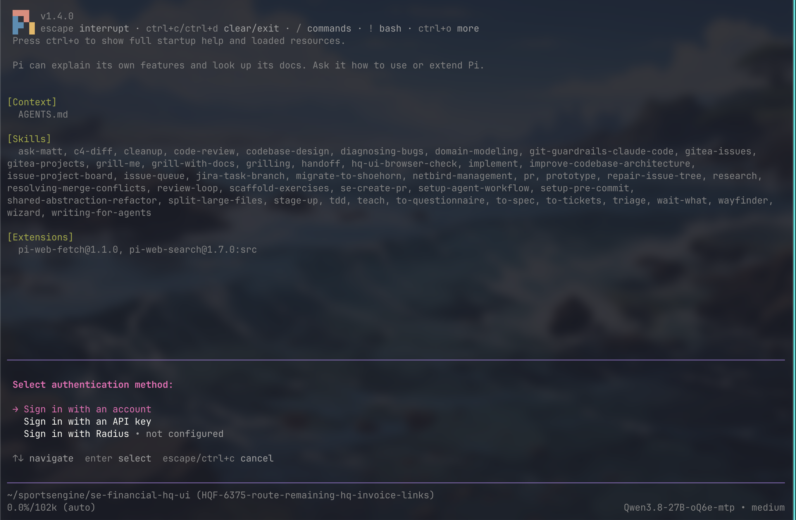
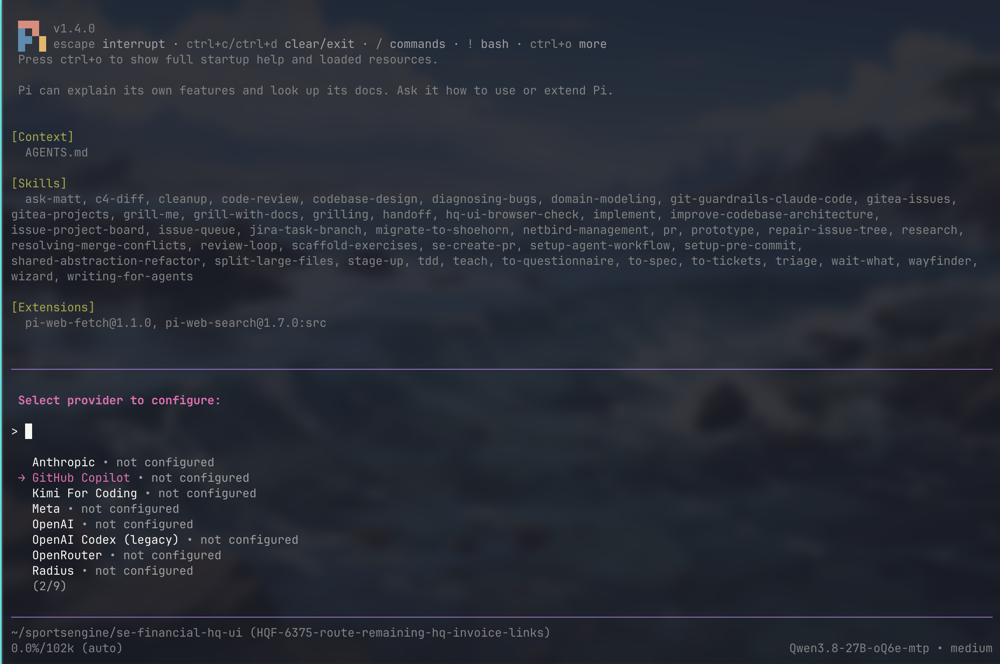
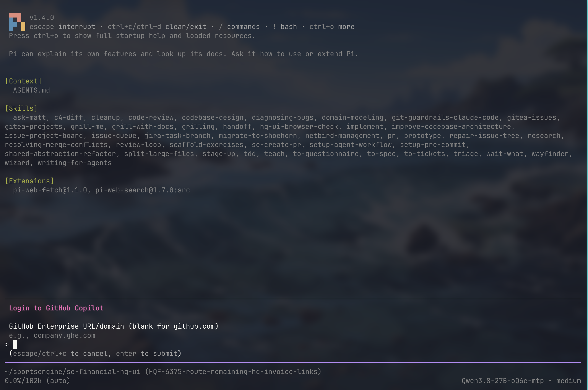
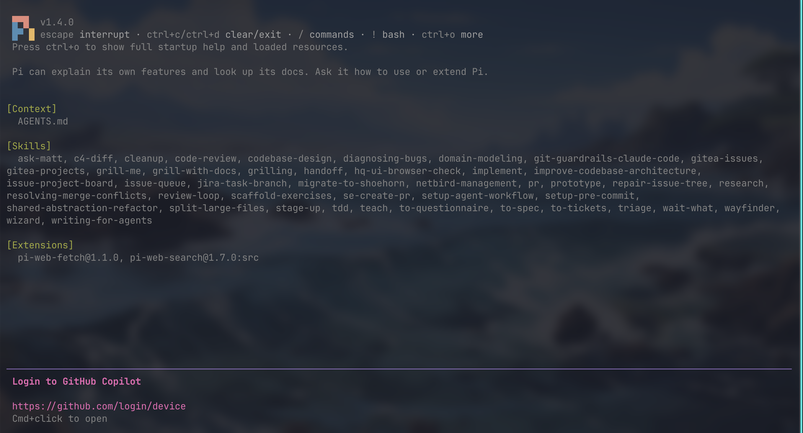

# Pi + GPT-6 Luna setup (macOS)

The macOS coding-agent installer currently sets up the Pi CLI, the two web extensions used in the evaluation, and pi-gui through Homebrew. It sets the **shared default for new CLI sessions and GUI threads** to `github-copilot/gpt-6-luna` with `high` thinking. On a fresh install, it also sets `web_search` to use that Copilot model. Existing threads keep their own model settings. The evaluation used `medium`, so `high` is a team preference that still needs a separate smoke test.

## Install

1. Install [Homebrew](https://brew.sh/) if needed.
2. From this repository, inspect prerequisites without changing the machine:

   ```sh
   bash scripts/macos-coding-agent-setup.sh --preflight
   ```

   The preflight checks macOS/Apple Silicon, Homebrew, Pi settings ownership, and reports which components are already present or will be installed. `pi-web-fetch` needs a Python runner for Trafilatura page extraction; the script accepts `uvx`, `uv`, `pipx`, or `pip-run` and installs `uv` only if none is available. Copilot sign-in is interactive later.

3. Run the installer:

   ```sh
   bash scripts/macos-coding-agent-setup.sh
   ```

   Re-running the script is safe. It preserves other keys in `~/.pi/agent/settings.json`, including other model settings and packages. It creates `~/.pi/agent/web-search.json` with the Copilot Luna model if that file is missing, and keeps any existing search configuration. Pi and extension versions are pinned for a fresh install; an existing Pi binary is left in place and its version is printed. The script installs the Chrome build needed by `web_fetch` without Puppeteer's unused headless shell.

## Sign in to GitHub Copilot through the Pi CLI

Use Pi in a terminal for sign-in. This has been more reliable in our setup tests than signing in through pi-gui. The screenshots show an existing Pi session, so its project name, skills, and model in the footer may differ from yours.

1. Open a terminal app such as **Terminal**, **iTerm2**, **Ghostty**, or **Kitty**. Type `pi` and press **Return**. After Pi opens, type `/login` and press **Return**.

   

2. Select **Sign in with an account** and press **Return**.

   

3. Select **GitHub Copilot** and press **Return**.

   

4. At the **GitHub Enterprise URL/domain** prompt, leave the field blank and press **Return** if your organization signs in at `github.com`. Enter a custom domain only if your organization gave you one.

   

5. **Command-click** the `https://github.com/login/device` link shown in Pi to open it in your browser. If your terminal does not open links that way, copy the link into your browser. Sign in to your **organization GitHub account**, then enter the one-time code displayed in your own Pi window on the GitHub page. The code is unique to your sign-in and is not shown in this screenshot. Complete GitHub's authorization prompts, then return to Pi and wait for confirmation.

   

No token needs to be pasted into this repository. When sign-in is complete, press **Ctrl+D** to exit Pi and return to your terminal prompt.

## Open pi-gui and verify

1. Open **pi-gui** from **Applications**, or press **Command+Space**, type `pi-gui`, and press **Return**. You can also run `open -a pi-gui` from a terminal prompt. If pi-gui was already open during sign-in, quit and reopen it. Pi and pi-gui share the same account and settings, so no separate GUI sign-in is needed.
2. Create a **new thread** in pi-gui. Confirm that its model is `github-copilot/gpt-6-luna` and its thinking level is `high`. Existing threads retain their previous selections.
3. In a terminal prompt, verify the Copilot connection and model:

   ```sh
   pi auth check --provider github-copilot --model gpt-6-luna
   pi --list-models gpt-6-luna
   ```

4. Test both web tools in a terminal prompt:

   ```sh
   pi --print --provider github-copilot --model gpt-6-luna --thinking high \
     --tools web_search,web_fetch -- \
     "Use web_search to find the official Python pathlib documentation, then use web_fetch to read it. Report its title and URL."
   ```

The installer verifies that Puppeteer's Chrome can launch. If it reports an incomplete browser cache, move only the reported Chrome build directory aside and rerun the installer. Avoid Homebrew `--zap` or clearing all Puppeteer caches for this test.

The default-setting step can also be run alone with `node scripts/set_pi_luna_defaults.mjs`. It sets the Pi defaults and creates `web-search.json` when missing. It respects `PI_CODING_AGENT_DIR` if a custom Pi agent directory is configured. Pi's [settings reference](https://pi.dev/docs/latest/settings) documents the default keys; [pi-gui](https://www.pi-gui.com/) confirms it uses Pi's settings. The [evaluation report](https://github.com/kmerrittNBC/agent-evals/blob/main/docs/executive-report-2026-10-15.md) describes the tested medium-reasoning setup.
